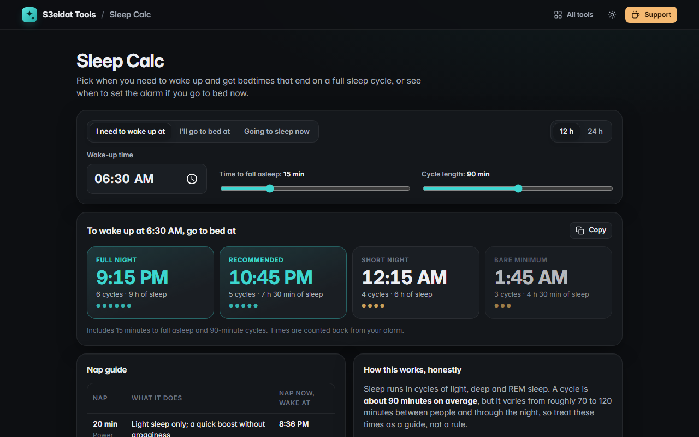

# Sleep Calc

> The best times to go to bed and wake up, in whole sleep cycles. Free, private, and it runs entirely in your browser.

### ▶ [Open Sleep Calc](https://s3eidat.github.io/sleep-calc/)



## Features

- **Wake-up time → bedtimes** for 6, 5, 4 (and 3) sleep cycles
- **Bedtime → wake-up times**, or **"going to sleep now"** using the current time
- Adjustable **time to fall asleep** (default 15 min) and **cycle length** (default 90 min, 70–110)
- **12 or 24 hour** clock
- **Nap guide**: 20, 30, 60 and full-cycle naps with "nap now, wake at" times
- A short, honest explanation: cycles vary between people, and total sleep (7–9 h for most adults) matters most
- Copy the result; preferences are remembered in this browser

Not medical advice.

## Privacy

Nothing you enter leaves your device. There is no server, no account, no analytics.
The page ships with a strict Content-Security-Policy (`connect-src 'self'`), so the browser
itself blocks any attempt to send data anywhere.

## Run it yourself

It's plain HTML, CSS and JavaScript with no build step:

```bash
git clone https://github.com/s3eidat/sleep-calc
cd sleep-calc
python -m http.server 8000
```

Then open http://localhost:8000.

## Support

If this saved you time, **[buy me a coffee ☕](https://s3eidat.github.io/coffee/)**. It keeps every tool free.

---

Part of **[S3eidat Tools](https://s3eidat.github.io/)**: 100+ free, private tools that run in your browser. MIT licensed.
